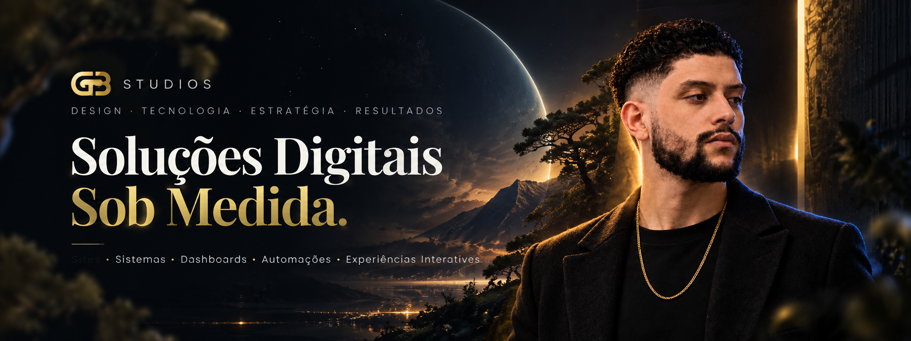
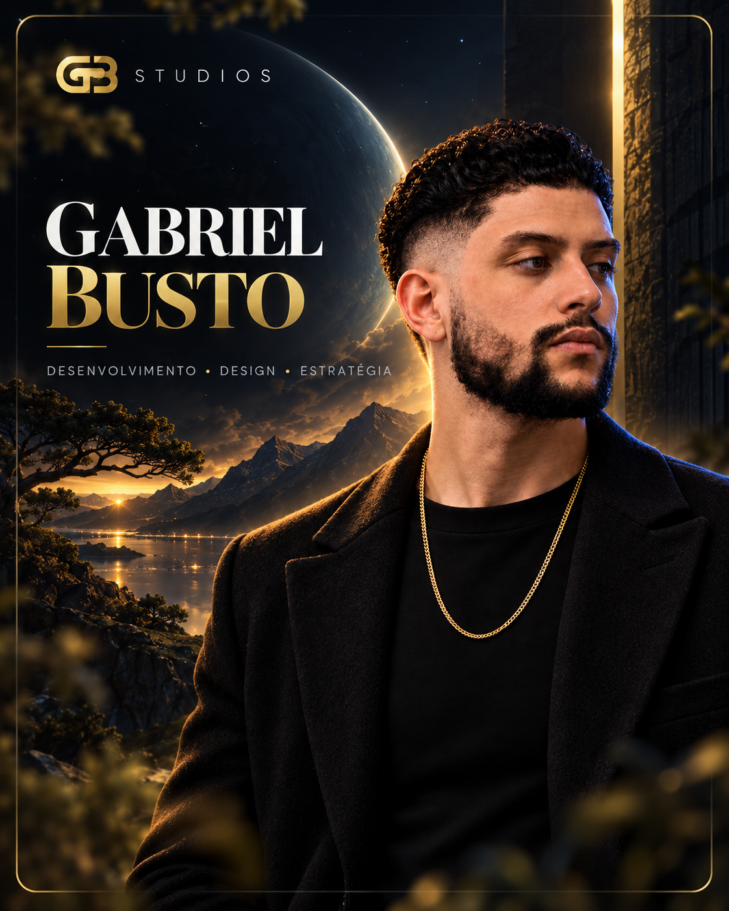
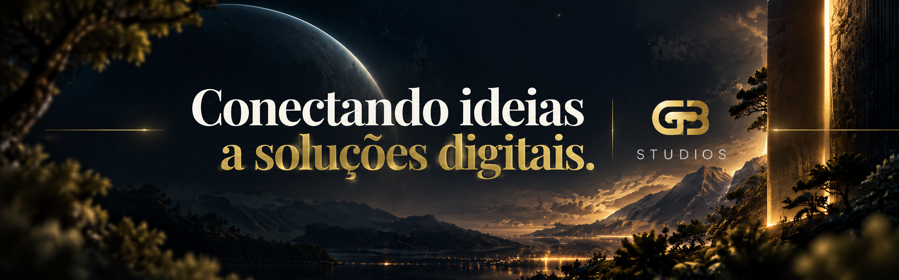

 

 

<table>
<tr>
<td width="43%" valign="top">

</td>
<td width="57%" valign="top">

## Sobre mim

Sou **Gabriel Busto**, desenvolvedor de software e fundador da **GB Studios**.

Desenvolvo soluções digitais sob medida, combinando **tecnologia, design e experiência de usuário** para transformar ideias em produtos que realmente funcionam.

### Atuação

- Sites e Landing Pages
- Sistemas Personalizados
- Dashboards e Planilhas Premium
- Automações e Integrações
- Banco de Dados e APIs
- Experiências Interativas
- Totens e soluções para eventos

### Foco atual

- Desenvolvimento full stack
- React e Node.js
- MySQL e integrações
- Interfaces responsivas
- Experiências digitais premium

</td>
</tr>
</table>

 

## Stack & Ferramentas

 

## GitHub Dashboard

 

## Projetos em destaque

<table>
<tr>
<td width="33%" valign="top">

### GB Studios

Portfólio oficial da GB Studios, com animações, experiências interativas, projetos e apresentação dos serviços.

**HTML • CSS • JavaScript**

[Ver projeto](https://gabrielprogramador206.github.io/gb-studios/)  
[Repositório](https://github.com/GabrielProgramador206/gb-studios)

</td>
<td width="33%" valign="top">

### Dashboard Financeiro

Dashboard empresarial desenvolvido para análise de gastos, indicadores e visualizações financeiras.

**React • JavaScript • Charts**

[Repositório](https://github.com/GabrielProgramador206/gb-studios-finance-dashboard)

</td>
<td width="33%" valign="top">

### Premium Promotional Wheel

Experiência interativa promocional responsiva para eventos e ativações.

**HTML • CSS • JavaScript**

[Repositório](https://github.com/GabrielProgramador206/premium-promotional-wheel)

</td>
</tr>
</table>

 

## GB Studios

 

**São Paulo • Brasil**

